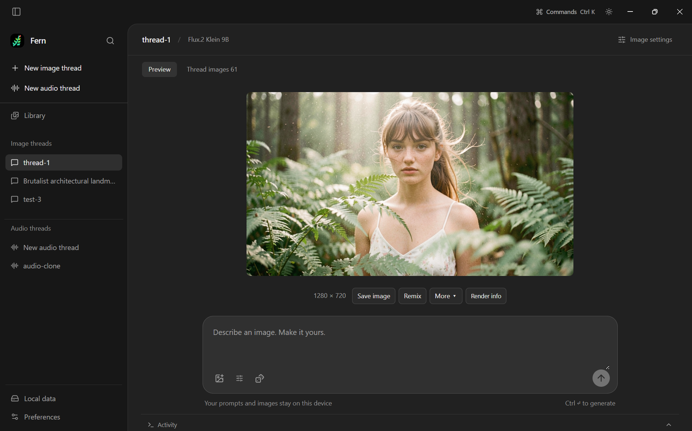

# Fern

Fern is a local-first studio for image generation, text conversations, and
speech generation. It runs on Windows and has a beta package for x86-64 Omarchy.
Each workspace has its own threads, settings, and output history.

Image threads support Flux.2 Klein, FLUX.3 Klein, Qwen Image 2.1 Turbo, and
Tame Pony SDXL OpenVINO models. Install available image models from **Library**;
model-specific controls keep unsupported sizes and sampling options out of the
composer. Image workflows include text-to-image, supported image guidance,
repeatable seeds, batch generation, and a local gallery. Intel GPU, NVIDIA GPU,
and CPU execution depend on the selected model and the installed runtime.

Text threads run local OpenVINO and GGUF chat models. Audio threads support Qwen3-TTS preset voices, voice
design, and reference-audio voice cloning. Set up downloads the selected
ready-made OpenVINO model from [xgirls on Hugging Face](https://huggingface.co/xgirls);
the app does not export source checkpoints during installation.

Use **New image thread** (Ctrl+N), **New audio thread** (Ctrl+Shift+N), or
**New text thread** (Ctrl+Alt+N) to open a workspace. Prompts, thread settings,
reference media, and generated outputs stay on the local machine. Threads
persist across app restarts.

See the [changelog](CHANGELOG.md) for release-by-release updates.



## Install

### Omarchy (x86-64 beta)

Download `fern-*-x86_64.pkg.tar.zst` from [GitHub Releases](https://github.com/xgirls-dev/fern/releases).
Install the package from the download directory, then open **Fern** from the
Omarchy app launcher.

```sh
sudo pacman -U ./fern-*-x86_64.pkg.tar.zst
```

For Intel GPU image generation and GGUF vision, install the Intel OpenCL and
Vulkan drivers from Arch's repositories.

```sh
sudo pacman -Syu intel-compute-runtime ocl-icd vulkan-intel vulkan-icd-loader
```

The package contains Python and OpenVINO. Models and the matching llama.cpp
runtime download inside Fern. The beta targets FLUX.2 Klein, GGUF chat and
vision, and image generation in chat on Intel GPUs. Qwen Image Turbo and
Qwen3-TTS setup are unavailable on Linux. NVIDIA GPU support is outside the beta.
CPU is available for models that support it.

### Windows

Download `Fern-Setup-*.exe` from the project's GitHub Releases page and run it.
The installer contains the desktop app, Python, and the pinned OpenVINO runtime.
On first launch, Fern prepares its bundled runtime. Install image models from
**Library**, the recommended language model from a text thread, and speech
models from an audio thread. Downloads are pinned to catalog revisions and
verified; interrupted downloads can resume. The first model load compiles for
the selected device and can take longer than later runs.

Open **Models → Text** to download **Gemma 4 E4B · GGUF**.
The download includes the Q4_0 language model and its matching vision projector.
Use **Import GGUF** to select a local instruction-tuned GGUF with a chat template.
For vision, select its matching `mmproj` GGUF in the same file picker. Attach an
image in a text thread and choose **Instant** or **Reasoning** when the model
supports both modes. Fern installs a pinned llama.cpp runtime on first use.
GGUF text runs through llama.cpp's OpenVINO backend. Chats with images use
Vulkan on Intel GPUs or llama.cpp on CPU when CPU is selected. Response details
show the backend and device used. Fern downloads the Vulkan backend on first
use and repairs missing backend files when you retry. If Vulkan cannot find a
compatible Intel GPU, the chat shows driver setup instructions for your platform.

In a text thread with a tool-capable model, ask Fern to create an image. **Chat
settings → Image generation** defaults to **Auto**, which prefers an installed
Klein 4B model. Fern renders one 512 × 512 image at a time in four steps.
The image appears in the chat and in the Library. Fern checks the generated
pixels before replying and includes recent images in follow-up requests. The
image tool requires a vision-capable chat model with its projector. Fern keeps
the chat and Klein models loaded on the Intel GPU between turns when the tool is enabled.

GGUF threads use an 8K token context by default. Choose 4K, 8K, or 16K in **Chat
settings**. Fern summarizes older turns when it needs room, carries the two
most recent images within the recent turns, and keeps the full transcript in
the thread. Response details show the context and compaction used.

To use LoRAs, install **Klein 4B · LoRA** or **Klein 9B · LoRA** in Models and
select it in an image thread. In **Image settings → LoRAs**, choose up to four
`.safetensors` adapters trained for that model size. Add files from disk or
download them from a Hugging Face or Civitai link. Enable the adapters you want,
adjust their strengths, and include their trigger words in the prompt. The LoRA
models use an Intel GPU and support up to four reference images per edit.
Klein 9B is licensed under the [FLUX Non-Commercial License](https://huggingface.co/black-forest-labs/FLUX.2-klein-9B/blob/main/LICENSE.md).

Fern automatically selects an available GPU where supported. CPU is available
as an explicit fallback. The NVIDIA plugin is bundled only when present in the
build environment and must match the OpenVINO runtime; Fern reports when that
plugin is unavailable rather than silently changing devices. **Stop** cancels
generation at a supported inference boundary without closing the app.

Windows requirements:

- Windows 10 or 11, 64-bit
- Free disk space for the selected models and their compiled-device caches;
  requirements vary by model
- An internet connection for the first model download
- An Intel GPU supported by OpenVINO, an NVIDIA GPU with a current driver and
  compatible CUDA libraries, or a CPU fallback
- NVIDIA support requires the OpenVINO NVIDIA plugin from `openvino_contrib`,
  built against the same OpenVINO runtime as Fern. The upstream plugin currently
  documents Ubuntu validation; Windows builds must use its Windows/CMake path.

The installer does not require a separate Python, Node.js, Git, or terminal
installation.

## Local data and cache management

Open **Data** in the Fern title bar to review disk usage, clear the compiled
generation cache, or reset local creative data. A local-data reset removes
generated images and WAV takes, thread/gallery metadata, saved prompts, and preferences while
preserving downloaded models and bundled runtimes.

Fern automatically prunes generation-cache files that have not been
used for 30 days. The cache is also limited dynamically between 1 GiB and 40 GiB
based on drive capacity, with a disk-relative free-space reserve of 5–20 GB.
Generated images and WAV takes are never deleted automatically.

## Development

This repository is an npm workspace. The Electron app lives in `apps/desktop`;
the Python backend and packaging tools live in `scripts`.

On Omarchy or Arch x86-64, install `base-devel`, `git`, `nodejs`, `npm`, and
`uv`. Run `npm ci` and `npm run package:omarchy` as a regular user. The package
is written to `apps/desktop/release-omarchy/`.

Windows prerequisites:

- Node.js 22 or newer
- Python 3.12
- PowerShell 7 (Windows PowerShell 5.1 also works for the provided scripts)

```powershell
npm install
python -m venv .venv
.\.venv\Scripts\python.exe -m pip install --upgrade pip
.\.venv\Scripts\python.exe -m pip install -r requirements.txt
npm run dev
```

`npm run dev` launches the Electron UI directly from source; it does not need
a release build or the bundled runtime archive. Development uses the local
`.venv` and opens the UI even when the model has not been downloaded yet. To
enable generation in development, download the model into the `models/`
directory with the bootstrap command below, then relaunch the app.

The development app stores downloaded models under `models/`. The Flux.2 Klein
9B model uses:

```text
models/flux2-klein-9b-circulus-int4
```

Download it with the same bootstrap used by the installer:

```powershell
.\.venv\Scripts\python.exe scripts\bootstrap_install.py `
  --model-dir models\flux2-klein-9b-circulus-int4
```

To build and install the OpenVINO NVIDIA plugin from the linked upstream source:

```powershell
.\scripts\install-openvino-nvidia-plugin.ps1
```

Then prepare the shared model for NVIDIA execution:

```powershell
.\.venv\Scripts\python.exe scripts\bootstrap_install.py `
  --adapter nvidia `
  --models-root models
```

The NVIDIA adapter calls `OVFlux2KleinPipeline.from_pretrained` with
`device="NVIDIA"`; Intel uses `device="GPU"`, and CPU uses `device="CPU"`.
Fern also keeps an explicit CPU option in the Device menu.

Useful commands:

```powershell
npm run typecheck
npm run build
npm run check:python
npm run check
```

Generated models, virtual environments, images, caches, bundled runtimes, and
installers are ignored by Git and must not be committed.

## Build the one-click installer

Prepare a clean build environment, keeping model experiment dependencies separate:

```powershell
python -m venv .venv-release
.\.venv-release\Scripts\python.exe -m pip install -r requirements-release.txt
npm run package
```

The build uses `.venv-release` when present, otherwise `.venv`, and rejects retired
Qwen Image dependencies or an Optimum Intel checkout that does not match
the locked `requirements-release.txt`. An explicit environment can be selected with
`scripts/build-installer.ps1 -SourceVenv <folder>`. Build the optional NVIDIA plugin
against that same environment before packaging if NVIDIA support is required.
The build script creates a self-contained runtime and writes the one-click NSIS
installer to `apps/desktop/release/`. Image and speech model weights are not embedded;
they download on demand from Hugging Face.

The runtime builder detects the base Python installation used by the selected environment. You
can override it when needed:

```powershell
.\scripts\bundle-python-runtime.ps1 -PythonHome "C:\Path\To\Python312"
```

## Repository layout

```text
apps/desktop/   Electron + React image, text, and audio workspaces
scripts/        OpenVINO model runtimes, setup, and packaging tools
.github/        CI and contribution templates
```

## Security and privacy

The API binds to `127.0.0.1` and accepts generation requests only from the local
desktop app. See [SECURITY.md](SECURITY.md) for reporting vulnerabilities.

## Contributing

See [CONTRIBUTING.md](CONTRIBUTING.md) for model integration and release guidance.

## License

MIT. See [LICENSE](LICENSE).
