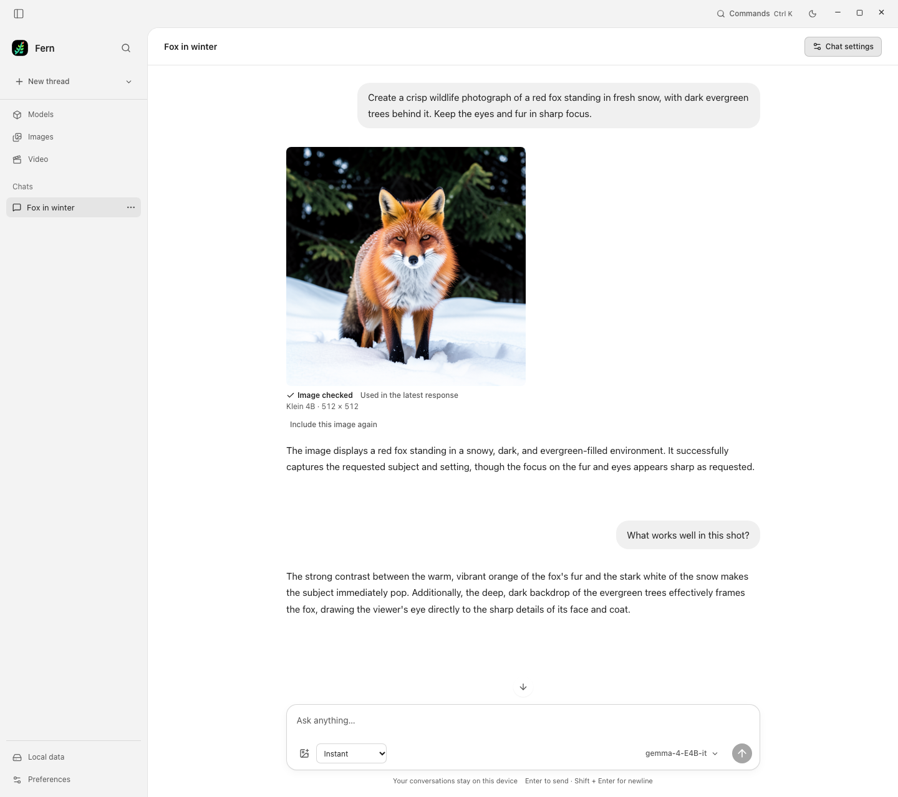

# Fern

**A local AI studio for chat, images, video, and speech.**

Talk to a model, attach a photo, or ask Fern to make an image right in the conversation. Create and remix images in a dedicated workspace, animate a still, or generate a speech take. Fern runs inference on your machine and keeps your threads, references, and outputs there.

[Download Fern](https://github.com/xgirls-dev/fern/releases/latest) · [macOS preview](#macos-apple-silicon-preview) · [Get started](#get-started) · [Platform support](#platform-support) · [Benchmarks](benchmarks/v0.1.45-intel-iris-xe.md) · [Changelog](CHANGELOG.md)



*Klein 4B generated the fox on Intel Arc B390. Gemma 4 E4B inspected the image in Chat and explained how the snow and dark evergreens frame the fox.*

## Get started

### Windows x64

Download `Fern-Setup-*.exe` and run it. The installer includes the desktop app, Python, and OpenVINO. Fern downloads model weights and additional inference engines when you set up a workflow. [Latest release](https://github.com/xgirls-dev/fern/releases/latest)

Use Windows 10 or 11 with current graphics drivers. Check the download size in **Models** and leave space for model preparation, compiled caches, and outputs.

### Omarchy x86-64 beta

Download the `fern-*-x86_64.pkg.tar.zst` package. Use `pacman -U` with the downloaded filename, then open **Fern** from the app launcher. [Latest release](https://github.com/xgirls-dev/fern/releases/latest)

```sh
sudo pacman -U ./fern-0.1.47-1-x86_64.pkg.tar.zst
```

The package includes Python and OpenVINO. Install the Intel OpenCL and Vulkan drivers for Intel GPU inference.

```sh
sudo pacman -Syu intel-compute-runtime ocl-icd vulkan-intel vulkan-icd-loader
```

Build the package from this checkout to use the [Fern Wallpapers panel for Omarchy Quattro](plugins/omarchy/fern-wallpapers/README.md).

### macOS Apple Silicon preview

Download the `Fern-*-macOS-arm64-preview.zip` on an M-series Mac running macOS 15 or later. Extract it, move **Fern.app** to **Applications**, and open it. [Apple Silicon preview](https://github.com/xgirls-dev/fern/releases/tag/v0.1.45-macos-preview.1)

The preview is unnotarized. If macOS blocks the first launch, open **System Settings → Privacy & Security** and choose **Open Anyway**. Install **Gemma 4 E4B · GGUF** for chat and vision and **Klein 4B · MLX** for images. [Apple's first-launch instructions](https://support.apple.com/en-us/102445)

### Start a session

- **Chat.** Go to **Models → Text**, install **Gemma 4 E4B · GGUF**, then choose **New thread → Chat**. The download includes the language model and its matching vision projector.
- **Create an image.** Go to **Models → Image** and install a model available for your device. **Klein 4B** is the smaller FLUX.2 option. Choose **New thread → Create image**, select the model, and enter a prompt.
- **Make an image in Chat.** Install Gemma 4 E4B and a compatible image model such as Klein 4B. Keep **Preferences → Compute → Generation device** set to **Available GPU**. In a Gemma chat, choose **Auto** or the installed model under **Chat settings → Image generation**. Try “Create a crisp wildlife photograph of a red fox in fresh snow,” then “What works well in this shot?”

First loads can take longer while Fern downloads an engine or compiles a model for your device. **Models** shows setup and download progress.

## Workspaces

### Chat and vision

Use a local OpenVINO text model or a compatible instruction-tuned GGUF. Attach an image to ask about it. When importing a GGUF through **Models → Text → Import GGUF**, select the matching `mmproj` file alongside the language model to enable vision. **Instant** and **Reasoning** are available on models that support both modes.

With a compatible tool-capable vision model, Chat can call Fern's image generator. Fern adds the results to the thread and **Images**, then sends the first image back to the chat model for inspection. **Image checked** appears once the inspection succeeds. Recent images can be used on follow-up turns. Choose **Include this image again** to bring an older image back into context.

Set the context length in tokens for GGUF chats. Fern starts at **8,192 tokens** or the model's declared maximum, whichever is lower. The prompt and response share that window. When a conversation outgrows the available context, Fern summarizes earlier turns for the model and keeps the original transcript in the thread. Response details show the backend, device, and context usage. Image generation in Chat needs GPU memory for both the language and image models.

In **Chat settings → Model**, set the response length, system prompt, and sampling controls, or save the inference settings as defaults for that model. GGUF models also expose Flash Attention, prompt batching, and KV cache precision. In **Chat settings → Image**, choose an image model and set its canvas, steps, guidance, seed, and batch size as supported by that model. Compatible models also accept ordered references and LoRA adapters. Each conversation remembers settings for each image model.

Edit an earlier message and resend it to try a different direction. Use **Versions** to switch between the resulting conversation and the earlier transcript.

For a failed reply, open **More message actions → Copy reply diagnostics** to share the Fern build, platform, runtime, device, and failing stage. The report leaves out conversation text, model names, file paths, and raw logs.

Use **Chat presets** to reuse a system prompt and sampling settings in another conversation. **Image style** adds the same style modifiers as Create Image, along with any text you want appended to generated image descriptions. The Chat image picker also supports installed Tame Pony, GPU-ready Qwen Image 2.1 Turbo, and compatible registered OpenVINO image models.

Duplicate a chat from its header or use **Fork chat here** on a message to continue from that point in a new thread. Both keep the conversation's settings and references to saved images.

Choose **New thread → Chat folder** to organize chats in the sidebar. Create subfolders from a folder's menu. Drag chats and folders to move them, or use **Move to folder…** from the item menu. Thread search matches the folder path. Deleting a folder moves its chats and subfolders up one level.

Use **Open split chat** in the chat header or drag a chat from the sidebar onto either side of the conversation. Each pane keeps its own conversation and settings. Drag the divider to resize the panes, or focus it and use the arrow keys. In a narrow window, switch panes with **Left chat** and **Right chat**. Closing a pane keeps its chat in the sidebar.

Use the paperclip in Chat, or drop files into the composer, to ask about local PDF, DOCX, TXT, and Markdown documents. Attachments stay with the conversation for follow-up questions. Fern selects excerpts from longer documents to fit the model's context. Open **Document sources** on a response to see the excerpts supplied to the model. For scanned PDFs, attach a copy with selectable text.

### Image creation and editing

Generate from a prompt, add reference images on supported models, and use seeds and render settings to make repeatable variations. The composer adjusts the available dimensions, steps, guidance, reference count, and batch size to the selected model.

- **FLUX.2 Klein 4B and 9B** cover generation and reference-guided edits. The Intel GPU **LoRA** variants support up to four reference images and four independently weighted adapters. Add a matching `.safetensors` file from disk or use a Hugging Face or Civitai link in **Image settings → LoRAs**.
- **Kromoss OPD · DMD2** uses the OPD 69,800 Q4_K weights and the matching DMD2 adapter. Create Image starts at **512 × 512** and **8 steps**, with rectangular presets, custom dimensions in multiples of 16, and an editable step count. The complete download, including companion files, is about **9 GB**. [Kromoss model card](https://huggingface.co/xgirls/Kromoss-OPD-DMD2-Q4_K-Intel-Vulkan)
- **MOSS Image · HaDeS**, **Z-Image Turbo**, and **SANA-Sprint 0.6B** offer more text-to-image options on Windows Intel GPUs. **Tame Pony SDXL** and **Qwen Image 2.1 Turbo** use OpenVINO. **FLUX.3 Klein · INT4** is an experimental text-to-image integration.
- **Custom OpenVINO image models** can be linked from a local export folder or downloaded from a compatible Hugging Face repository through **Models → Image → Add custom model**. Select the model family that matches the export.

Open **Images** to browse renders, inspect settings, save a copy, or remix a result. Image, chat, and speech threads keep their own drafts, settings, and history. Use **Search threads** to pick up previous work and **Ctrl+K** to open the command palette.

### Video from a still

On Windows with a compatible Intel GPU, install **Wan 2.2 Turbo** in **Models → Video**. Open **Video**, choose a PNG, JPEG, or WebP first frame, and describe the motion. You can also send a generated image to Video with **Animate image**.

The current preset makes a **544 × 704** portrait clip with **21 frames at 16 fps**, about **1.3 seconds**. Preview the clip, revisit it in the clip history, or export it as WebM.

### Speech

Choose **New thread → Create speech** on Windows. Use a **Qwen3-TTS** preset voice, design a voice from a description, or clone a voice from a WAV or FLAC reference you have permission to use. Fern sets up the selected model in the app. Play takes in the thread and save them as WAV.

## Platform support

| Workflow | Windows x64 | Omarchy x86-64 beta | macOS Apple Silicon preview |
| --- | --- | --- | --- |
| FLUX.2 Klein images and edits | Intel GPU, or CPU on supported variants. LoRA variants require Intel GPU. | Intel GPU, or CPU on supported variants | Klein 4B · MLX on Apple GPU. 512 × 512 text-to-image. |
| Other managed image models | Kromoss, MOSS, Z-Image, and SANA-Sprint require Intel GPU. Check **Models** for other families. | The beta targets FLUX.2 Klein | Unavailable |
| Chat and vision | OpenVINO or GGUF chat. GGUF vision uses Intel GPU via Vulkan or explicitly selected CPU. | OpenVINO or GGUF chat. GGUF vision uses Intel GPU via Vulkan or explicitly selected CPU. | Gemma 4 E4B · GGUF on Metal |
| Images in Chat | Compatible Intel GPU, tool-capable chat model with a vision projector, and supported image model | Same requirements, with a compatible FLUX.2 Klein image model | Gemma 4 E4B and Klein 4B · MLX on Apple GPU |
| Wan 2.2 Turbo video | Compatible Intel GPU | Unavailable | Unavailable |
| Qwen3-TTS speech | Available | Unavailable | Unavailable |

**Available GPU** is the default in Preferences. Choose **CPU** explicitly for models that support it. NVIDIA on Windows requires a build with the matching OpenVINO NVIDIA plugin and a model that supports that path.

On Windows and Omarchy, text-only GGUF uses llama.cpp with OpenVINO, and GGUF vision on Intel uses llama.cpp with Vulkan. On Apple Silicon, llama.cpp uses Metal for GGUF chat and vision. Fern downloads pinned engines as needed. Your operating system supplies the graphics drivers.

## Benchmarks

On Intel Iris Xe, SANA-Sprint reached visible output in **76.9 seconds on the first run and 7.5 seconds on repeat**. The Windows v0.1.45 benchmark covers ten image, video, and speech workloads plus 24 multi-turn Gemma responses. It includes the settings and runtime cache observations. [Intel Iris Xe benchmark](benchmarks/v0.1.45-intel-iris-xe.md)

## Models, storage, and privacy

**Models** lets you install, repair, and remove managed downloads, and link compatible local models. Fern verifies built-in downloads against pinned catalogs. Removing a linked local OpenVINO model preserves the source folder.

Inference runs on your device. Prompts, conversations, reference media, and generated files stay in your local workspace. An internet connection is used to fetch model files and additional engines. Once those files are installed, generation can run offline.

**Local data** shows disk usage. **Clear Cache** removes compiled generation files, which Fern rebuilds on demand. **Clear Local Data** clears creative history, outputs, and preferences and keeps installed models and runtimes. Fern prunes old cache files automatically. Save copies of outputs you want to keep before clearing local data.

## Development

The Electron and React app lives in [`apps/desktop`](apps/desktop), the Python backend and model catalogs in [`scripts`](scripts), and workflow and backend checks in [`tests`](tests). The desktop backend binds to localhost.

### Run from source on Windows

Use Git, Node.js 22+, npm 10+, Python 3.12, and PowerShell. Run these commands from the repository root.

```powershell
npm ci
python -m venv .venv
.\.venv\Scripts\python.exe -m pip install --upgrade pip
.\.venv\Scripts\python.exe -m pip install --no-deps -r requirements-release.txt
.\.venv\Scripts\python.exe -m pip check
npm run dev
```

Use **Models** to set up the models you need. With the virtual environment active, run `npm run check` for TypeScript, Python, and the production build. Run `npm run test:ui` for renderer workflows and `npm run test:electron --workspace @fern/desktop` for Electron and backend integration.

### Build installable packages

| Target | Command | Output |
| --- | --- | --- |
| Windows x64 | `npm run package` with the locked runtime installed in `.venv` or `.venv-release` | `apps/desktop/release/Fern-Setup-*.exe` |
| Omarchy x86-64 | On Arch x86-64, install `base-devel`, `git`, `nodejs`, `npm`, and `uv`. Run `npm ci`, then `npm run package:omarchy` as a regular user. | `apps/desktop/release-omarchy/fern-*-x86_64.pkg.tar.zst` |

The release workflow builds both packages, runs smoke tests, and publishes the assets. [Release workflow](.github/workflows/release.yml) · [Contributing](CONTRIBUTING.md) · [Design system](DESIGN_SYSTEM.md)

## Feedback and licenses

For an inference issue, include the Fern version, operating system, GPU and driver, selected model and device, and the error shown in Fern. Use the private reporting path for vulnerabilities. [GitHub Issues](https://github.com/xgirls-dev/fern/issues) · [Security policy](SECURITY.md)

Fern is MIT licensed. Models, weights, and bundled third-party components have their own terms. Review the upstream license and the download's model card before using or redistributing a model. [Fern license](LICENSE) · [Fern models on Hugging Face](https://huggingface.co/xgirls)
